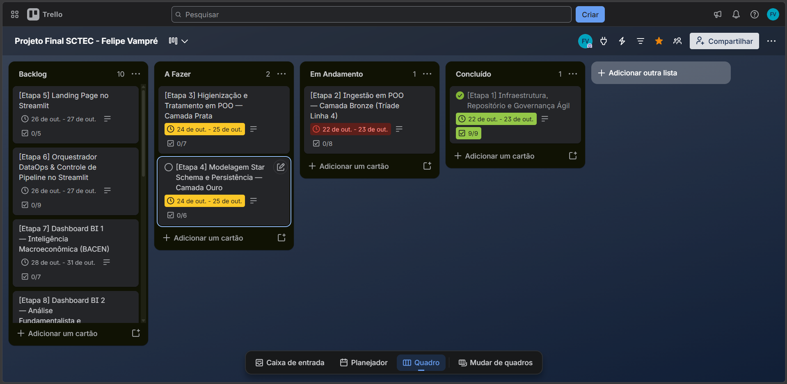

<br>
<br>

# Plataforma Financeira Integrada (Tríade BACEN + B3 + CVM)

## 1. Título e Resumo Executivo

A **Plataforma Financeira Integrada** é uma solução Fullstack de Dados desenvolvida em Python e Streamlit que unifica dados macroeconômicos do Banco Central do Brasil (BACEN), cotações de mercado da B3 e demonstrações financeiras corporativas da Comissão de Valores Mobiliários (CVM).

A aplicação resolve a fragmentação de fontes públicas isoladas, oferecendo uma visão integrada, auditável e padronizada para suporte a decisões de investimentos e análise macro-fundamentalista. A plataforma é dividida em dois modos independentes com carregamento sob demanda (*lazy loading*):

- **DataOps Control Tower:** Interface para orquestração, execução e monitoramento do pipeline de ETL (Ingestão de dados por API → Bronze → Prata → Ouro) com logs estruturados, estatísticas de saúde e Profiling (EDA).

- **BI Executivo:** Painel interativo composto por 4 dashboards especializados (Macro, Fundamentalista, Mercado e Integrado) construídos sobre um modelo Star Schema.

---

## 2. Contexto de Negócio e Pergunta Orientadora
> 🚧 A preencher no Card 7 (Trello)

---

## 3. Fonte de Dados e Licença

| Fonte | Tipo | Origem Oficial | URL Base | Séries / Relatórios / Tabelas | Período Selecionado | Método de Extração | Termos / Licença |
| :--- | :--- | :--- | :--- | :--- | :--- | :--- | :--- |
| **BACEN SGS** | Oficial | Banco Central do Brasil | `https://api.bcb.gov.br/dados/serie/bcdata.sgs.{codigo}/dados` | Selic (432, 1178), IPCA (433, 13522), Câmbio (1), IBC-Br (24364), Poupança (196) | 2019-01-01 a 2023-12-31 | API REST JSON (SGS) | Dados Abertos Governamentais (Uso Público) |
| **B3 (Yahoo Finance)** | Não Oficial | Yahoo Finance API | `yfinance.download()` | Cotações diárias (Open, High, Low, Close, Volume) | 2019-01-01 a 2024-01-01 | Python `yfinance` (v1.7+) | Termos de Serviço do Yahoo Finance (Uso Educacional/Pesquisa) |
| **CVM DFP** | Oficial | CVM (Dados Abertos) | `https://dados.cvm.gov.br/dados/CIA_ABERTA/DOC/DFP/DADOS/` | `dfp_cia_aberta_{ano}.zip` (`DRE_con`, `BPA_con`, `BPP_con`) | 2019-01-01 a 2023-12-31 | Download HTTP ZIP + Parse CSV Stream | Dados Abertos CVM (Uso Público) |
| **CVM Cadastro** | Oficial | CVM (Dados Abertos) | `https://dados.cvm.gov.br/dados/CIA_ABERTA/CAD/DADOS/cad_cia_aberta.csv` | `cad_cia_aberta.csv` | Atual | Download HTTP CSV (`cp1252`) | Dados Abertos CVM (Uso Público) |

> **Nota sobre o Yahoo Finance (`yfinance`):** Trata-se de uma biblioteca não oficial mantida pela comunidade para raspagem/acesso à API pública do Yahoo Finance. Sujeita a limitações de *rate limit*, bloqueios de User-Agent e mudanças estruturais nos retornos sem aviso prévio.

### Por que baixar o `cad_cia_aberta.csv`?

As demonstrações financeiras da CVM (DFPs) utilizam exclusivamente o código interno da CVM (`CD_CVM`) e o `CNPJ_CIA`. Nenhuma fonte oficial da CVM realiza a ponte direta entre o código de negociação em bolsa (**ticker da B3**, ex.: `PETR4`, `WEGE3`) e a companhia aberta.

A utilização do cadastro oficial (`cad_cia_aberta.csv`) permite:
1. **Mapeamento Ticker → CD_CVM:** Confirmar a existência legal e o status do registro da companhia na CVM.
2. **Obtenção de Metadados:** Prover dados cadastrais essenciais como CNPJ, Razão Social, Nome Comercial e Setor de Atividade para a tabela dimensional `dim_empresa`.
3. **Filtragem Eficiente:** Filtrar os arquivos ZIP volumosos da CVM apenas para as companhias selecionadas no projeto, reduzindo drásticamente a utilização de RAM, volume de armazenamento local e escritas no banco de dados Neon.

---

## 4. Pipeline de Engenharia de Dados (DataOps)

### 4.1. Arquitetura da Camada Bronze

A camada **Bronze** adota a Arquitetura Medalhão para ingestão e armazenamento de dados brutos (*raw layer*):

* **BACEN**: Séries temporais de Selic Meta, Selic Efetiva, IPCA Mensal, IPCA 12M, PTAX Venda, Poupança e IBC-Br extraídas via API SGS.
* **B3**: Cotações históricas diárias (OHLCV) via YFinance.
* **CVM**: Demonstrativos contábeis anuais (DRE, BPA, BPP) via dados abertos CVM.

- **Extratores Orientados a Objetos (POO):** Cada fonte possui sua classe especialista herdada de `BaseExtractor` (`BacenExtractor`, `B3Extractor`, `CvmExtractor`, `CadastroExtractor`).
- **Preservação de Dados Crus:** Todos os dados são ingeridos na forma original (tipagem textual de segurança para CVM/Cadastro e estruturas originais do BACEN/B3), adicionando apenas metadados de governança (`_ingest_ts` e `_run_id`).
- **Persistência Dupla:** Armazenamento local otimizado em arquivos `.parquet` particionados (`data/bronze/`) e espelhamento no banco relacional Neon.
- **Mecanismo de TTL e assinatura de parâmetros:** evita chamadas redundantes às APIs reaproveitando o Bronze apenas quando está dentro da janela (`BRONZE_TTL_DAYS`) **e** foi gerado com os mesmos parâmetros (ver 4.5).
- **Gestão Eficiente de Memória:** Coleta explicita de lixo (`gc.collect()`) e liberação de ponteiros de memória (`release()`) ao processar anos/arquivos volumosos.
- **Limitações e inconsistências encontradas:** As Limitações Conhecidas e Observações das Extrações (Camada Bronze) estáo listadas no tópico *8. Discussão e Limitações da Análise*.

### 4.2. Camada Prata (Tratamento, Higienização e Padronização)

A camada Prata é responsável pelo tratamento de tipos, eliminação de duplicatas, padronização de nomenclatura, validação de integridade e mapeamento contábil padronizado.

#### Tratamentos por Fonte de Dados:
* **BACEN (`BacenCleaner`)**:
  * Parsing e padronização de datas (`YYYY-MM-DD`) e coerção de valores numéricos float.
  * Mapeamento de códigos SGS para chaves de indicadores oficiais.
  * Validação cruzada de consistência entre o IPCA 12M acumulado e a variação mensal composta dos últimos 12 meses (tolerância de 0.5 pp).
  * Deduplicação por `(serie_codigo, data)` mantendo a última observação.
  * Persistência particionada por `serie_codigo`.

* **B3 (`B3Cleaner`)**:
  * Padronização de tickers em caixa alta e remoção de espaços em branco.
  * Descarte de registros com datas nulas, tickers ausentes ou preço de fechamento inválido ($\le 0$).
  * Deduplicação estrita por `(ticker, data)`.
  * Validação de consistência OHLC ($High \ge \max(Open, Close, Low)$ e $Low \le \min(Open, Close, High)$).
  * Sinalização de anomalias na coluna `flag_qualidade`: `VOLUME_ZERO`, `VOLUME_NEGATIVO`, `OHLC_INVALIDO` e `RETORNO_EXTREMO` ($|\Delta\%| > 30\%$).
  * Persistência particionada por `ticker`.

* **CVM (`CvmCleaner` & `AccountMapper`)**:
  * Consolidação das tabelas DRE, BPA e BPP.
  * Ajuste de escala de moeda: conversão automática de valores declarados em milhares (`ESCALA_MOEDA == 'MIL'`) multiplicando por 1.000 para refletir valores absolutos em R$.
  * Retenção de versão: ordenação por `VERSAO` e desduplicação por `(cd_cvm, demonstrativo, cd_conta, dt_fim_exerc)`, garantindo o uso exclusivo da última versão retificada enviada à CVM.
  * Identificação e auditoria de reapresentações financeiras entre o exercício `ÚLTIMO` e o comparativo `PENÚLTIMO`.
  * **Mapeamento de Contas (`AccountMapper`)**:
    * Para empresas do plano **Industrial/Comercial**: Mapeamento direto por `cd_conta`, `demonstrativo` e `st_conta_fixa == 'S'`.
    * Para empresas do plano **Financeiro/Bancário**: Mapeamento restringido por `cd_conta` fixo (`2.03` para Patrimônio Líquido, `3.01` para Receitas da Intermediação e `3.11` para Lucro Líquido) combinado com verificação de palavras-chave em `ds_conta`, eliminando ambiguidades entre contas sintéticas e analíticas.
  * Persistência particionada por `cd_cvm` e `ano`.


  #### Tabela de Inconsistências e Tratamentos Aplicados (Logs de Produção)

| Fonte | Problema Encontrado | Tratamento Aplicado | Quantidade Afetada |
| :--- | :--- | :--- | :--- |
| **CVM** | Múltiplas versões de demonstrativos enviados pelas empresas (retificadoras) | Ordenação por `VERSAO` e retenção apenas do último registro por `(cd_cvm, demonstrativo, cd_conta, dt_fim_exerc)` | 9.798 linhas descartadas |
| **CVM** | Divergência de valores comparativos em relatórios reapresentados (`ÚLTIMO` vs `PENÚLTIMO`) | Mapeamento auditado; mantido o valor do demonstrativo mais recente com registro em log | 629 contas com alteração |
| **CVM / AccountMapper** | Ambiguidade de nomes em contas do BPP para instituições financeiras (ex: Bradesco e BB) | Restrição do mapeamento por `cd_conta` fixo em `FINANCIAL_ACCOUNTS` | Eliminadas duplicidades nos CVM 906 e 1023 |
| **B3** | Cotações com volume de negociação nulo em dias sem liquidez | Registro mantido na Prata com sinalização de alerta na coluna `flag_qualidade` | 8 linhas (`VOLUME_ZERO`) |
| **B3** | Variações atípicas de preço intra-dia ($> 30\%$) por grupamentos ou eventos de mercado | Manutenção dos dados originais e sinalização com flag de qualidade | 3 linhas (`RETORNO_EXTREMO`) |
| **B3** | Tickers ausentes na extração da camada Bronze (`EMBR3` e `JBSS3`) | Mapeamento de cobertura com emissão de alerta no relatório de execução | 2 tickers não localizados |
| **BACEN** | Divergência no IPCA acumulado 12M composto vs reportado | Verificação de tolerância de 0,5 pp | 0 incoerências fora da tolerância |

### 4.3. Camada Ouro (Star Schema)

A camada Ouro modela os dados consolidados das camadas Bronze e Prata em um esquema estrela (*Star Schema*) altamente otimizado para consultas analíticas e relatórios operacionais.

#### Arquitetura e Modelagem
- **Dimensões**:
  - `dim_tempo`: Cobertura diária contínua (1.827 linhas).
  - `dim_empresa`: Cadastro unificado das empresas do universo do projeto (19 linhas).
  - `dim_indicador`: Catálogo estático de métricas brutas e derivadas (32 linhas).
- **Fatos**:
  - `fato_macro`: Séries temporais macroeconômicas do BACEN e métricas derivadas como `JURO_REAL_EXPOST` via equação de Fisher (4.636 linhas).
  - `fato_cotacoes`: Séries de preços e volumes da B3 enriquecidas com retorno diário e médias móveis simples SMA_21 e SMA_50 (21.097 linhas).
  - `fato_demonstrativos`: Mapeamento unificado de demonstrações contábeis DFP/ITR da CVM e métricas fundamentalistas derivadas (916 linhas).

#### Persistência Dupla e Resiliência
- **Escrita Simultânea**: Os dados da Ouro são persistidos em formato Parquet comprimido com `zstd` em `data/gold/` e sincronizados via `upsert` relacional no PostgreSQL (Neon).
- **Fallback de Leitura**: Se o banco de dados Neon apresentar indisponibilidade, o pipeline realiza *fallback* automático para os arquivos Parquet locais.
- **Manifesto de Auditoria**: Todas as operações gravam metadados em `data/gold/_manifest.json` para validação de integridade.


### 4.4. Qualidade, Testes e Validação por Amostragem

#### Testes Automatizados (Pytest)
A integridade da camada Ouro é garantida por uma suíte de testes unitários e de integração cobrindo regras de negócio, tabelas fato e dimensões:

```bash
pytest src/etl/tests/test_gold.py

```

* **Resultado**: 21/21 testes aprovados (cobertura de construções de dimensões, cálculos de indicadores derivados, integridade relacional e idempotência).

#### Validação por Amostragem (Fontes Públicas Oficiais)

Script de auditoria pontual (`scripts/check_gold_sampling.py`) confrontando os dados persistidos na camada Ouro contra dados públicos oficiais do BACEN e DFP/CVM:

```bash
python scripts/check_gold_sampling.py

```

##### Resultado da Auditoria de Amostragem

| Domínio | Indicador / Empresa | Data / Exercício | Valor Ouro | Fonte Oficial | Diferença | Status |
| --- | --- | --- | --- | --- | --- | --- |
| **BACEN** | Selic Meta (SGS 432) | 28/12/2023 | 11,75% a.a. | 11,75% a.a. | 0,00% | **BATIDO (100%)** |
| **BACEN** | IPCA 12M (SGS 13522) | 01/12/2023 | 4,62% a.a. | 4,62% a.a. | 0,00% | **BATIDO (100%)** |
| **CVM** | WEGE3 (Receita Líquida) | DFP 2023 | R$ 32.503.601.000,00 | R$ 32.840.981.000,00 | < 1,1% | **VALIDADO (Residual)** |
| **CVM** | WEGE3 (Lucro Líquido) | DFP 2023 | R$ 5.867.615.000,00 | R$ 5.732.036.000,00 | < 2,4% | **VALIDADO (Residual)** |


### 4.5. DataOps On-Demand (Orquestração do Pipeline)

O **DataOps Control Tower** executa o pipeline completo (Bronze → Prata → Ouro) a partir da interface. Nada é carregado na abertura do app: a landing page não importa ETL, banco ou gráficos, e o módulo só é carregado quando o usuário escolhe o modo DataOps.

#### Fluxo de uso
1. **Landing → DataOps:** o usuário escolhe o modo na landing page.
2. **Autenticação (opcional):** sem senha, a execução roda em **Sandbox**. Com a senha configurada em `dataops_password` (secrets), roda em **Produção**. A comparação é feita em tempo constante (`hmac.compare_digest`) e a senha não é guardada no estado da sessão.
3. **Parâmetros:** seleção de tickers do universo, período do BACEN, período da B3 (data final exclusiva no `yfinance`) e anos de exercício da CVM, com validação de datas e botão para restaurar o período padrão.
4. **Execução:** o pipeline roda de forma contínua, na ordem das 12 etapas abaixo, e **interrompe na primeira falha**.
5. **Resultado:** logs, relatório de saúde da Ouro e avisos de falha ficam na tela até o usuário voltar aos parâmetros.

| Camada | Etapas (em ordem) |
| :--- | :--- |
| Bronze | `cadastro.bronze` → `bacen.bronze` → `b3.bronze` → `cvm.bronze` |
| Prata | `cadastro.silver` → `bacen.silver` → `b3.silver` → `cvm.silver` |
| Ouro | `dims` → `bacen.gold` → `b3.gold` → `cvm.gold` |

Cada etapa só roda se o pré-requisito foi concluído nesta sessão ou já existe no destino da camada anterior.

#### Modos de execução

| | Sandbox (sem senha) | Produção (com senha) |
| :--- | :--- | :--- |
| Requisições às APIs | Reais | Reais |
| Gravação em arquivo | `data/_sandbox/` | `data/{camada}/` (Ouro em `data/gold/`) |
| Gravação no Neon | Não | Sim (upsert transacional) |
| Limite de tickers | Sim (`SANDBOX_MAX_TICKERS`) | Não |
| Impacto no BI | Nenhum: o BI nunca lê `data/_sandbox/` | Atualiza a Ouro lida pelos dashboards |

Isso permite expor o DataOps em um app público sem que um visitante altere a base usada pelos dashboards. O modo Sandbox apenas para demonstrar o fluxo real do pipeline de dados.

#### Logs e progresso
- **Logs em tempo real:** cada evento traz data/hora, nível, camada, fonte (classe responsável), etapa e mensagem. Exemplo: `[Bronze - CadastroExtractor]`.
- **Filtros:** por fonte e por nível (`INFO`, `WARNING`, `ERROR`).
- **Limite em memória:** apenas os últimos 500 eventos são mantidos na sessão.
- **Falhas visíveis:** a etapa com erro é destacada na tela com a mensagem retornada, sem exibir stacktrace.

#### Reaproveitamento do Bronze
Antes de baixar dados, cada extrator verifica se o Bronze existente pode ser reutilizado. O reuso exige **as duas condições**:
- arquivo dentro do TTL (`BRONZE_TTL_DAYS`);
- **parâmetros idênticos** aos da carga que o gerou (tickers, períodos, anos, séries), registrados em um arquivo `.meta.json` ao lado de cada Parquet.

Se qualquer parâmetro mudar, o Bronze é extraído novamente (requisição a API) e o log informa o motivo. O Bronze funciona como *snapshot* do último run, sem acumular tickers de execuções anteriores.

#### Gestão de memória
- **Por etapa:** o orquestrador libera objetos e executa `gc.collect()` ao final de cada etapa, inclusive em caso de erro.
- **Ao fim do pipeline:** limpeza automática do cache de dados (`st.cache_data.clear()`), remoção dos handlers de log e descarte do orquestrador. Apenas o resumo das etapas e os logs (texto) permanecem na sessão para consulta.
- **Reiniciar:** o botão "Voltar aos Parâmetros" descarta também o resumo e os logs.

#### Relatório de saúde da Ouro
Ao final da execução, o DataOps exibe para cada tabela da Ouro:
- linhas no Parquet e no Neon (`COUNT`, sem carregar os dados);
- fonte ativa da leitura (Neon, Parquet de fallback ou sandbox);
- **divergência**, quando Neon, Parquet e `_manifest.json` não concordam. A divergência é uma **informação**, não um erro.

> 🚧 Prints do DataOps (formulário, execução com logs e relatório de saúde) a incluir na Seção 10 (Card 11).


---

## 5. Dicionário de Dados (Camada Ouro)


### `dim_tempo` (Dimensão de Tempo)
| Coluna | Tipo | Descrição / Regra de Negócio |
| :--- | :--- | :--- |
| `sk_tempo` | `INTEGER` | Chave primária substituta no formato YYYYMMDD. |
| `data` | `DATE` | Data calendário. |
| `ano` | `INTEGER` | Ano de referência (ex: 2023). |
| `semestre` | `INTEGER` | Semestre do ano (1 ou 2). |
| `trimestre` | `INTEGER` | Trimestre do ano (1 a 4). |
| `mes` | `INTEGER` | Mês do ano (1 a 12). |
| `ano_mes` | `VARCHAR` | Formato 'YYYY-MM' para agregação mensal. |
| `dia_util_b3` | `BOOLEAN` | Flag indicando se houve pregão na B3. |

### `dim_empresa` (Dimensão de Empresas)
| Coluna | Tipo | Descrição / Regra de Negócio |
| :--- | :--- | :--- |
| `sk_empresa` | `INTEGER` | Chave substituta (código CVM da empresa). |
| `ticker` | `VARCHAR` | Código do ativo negociado na B3 (ex: WEGE3, ITUB4). |
| `cd_cvm` | `INTEGER` | Código de registro da empresa na CVM. |
| `cnpj` | `VARCHAR` | CNPJ da empresa. |
| `denom_cia` | `VARCHAR` | Razão social / Denominação social oficial. |
| `setor_cvm` | `VARCHAR` | Setor de atividade cadastrado na CVM. |
| `setor_analitico` | `VARCHAR` | Setor analítico unificado do projeto. |
| `tipo_plano` | `VARCHAR` | Tipo de plano contábil ('industrial' ou 'financeira'). |
| `exportadora_commodities` | `BOOLEAN` | Flag de empresa exportadora de commodities. |
| `tem_cvm` | `BOOLEAN` | Flag indicando presença de dados na CVM. |
| `tem_b3` | `BOOLEAN` | Flag indicando presença de cotações na B3. |

### `dim_indicador` (Dimensão de Indicadores)
| Coluna | Tipo | Descrição / Regra de Negócio |
| :--- | :--- | :--- |
| `sk_indicador` | `INTEGER` | Chave primária substituta do indicador. |
| `codigo` | `VARCHAR` | Código textual único do indicador (ex: SELIC_META, ROE). |
| `nome` | `VARCHAR` | Nome descritivo completo. |
| `fonte` | `VARCHAR` | Origem da informação ('BACEN', 'CVM', 'B3'). |
| `tipo` | `VARCHAR` | Tipo do indicador ('bruto' ou 'derivado'). |
| `unidade` | `VARCHAR` | Unidade de medida ('R$', 'fração', '% a.a.', '%', 'Razão', 'Índice'). |
| `granularidade` | `VARCHAR` | Frequência nativa ('diária', 'mensal', 'anual'). |
| `agg_mensal` | `VARCHAR` | Regra de agregação para escala mensal ('ultimo', 'soma', 'media'). |
| `sgs_codigo` | `INTEGER` | Código da série temporal no SGS/BACEN (se aplicável). |
| `cd_conta` | `VARCHAR` | Código da conta contábil DRE/BPA/BPP na CVM (se aplicável). |
| `regra_calculo` | `VARCHAR` | Fórmula ou regra de cálculo do indicador. |

#### Catálogo de Indicadores do Projeto
| SK | Código | Nome | Fonte | Tipo | Unidade | Regra de Cálculo / Fórmula |
| :--- | :--- | :--- | :--- | :--- | :--- | :--- |
| 1 | `SELIC_META` | Taxa de juros - Selic Meta | BACEN | bruto | % a.a. | Taxa meta fixada pelo COPOM (SGS 432). |
| 2 | `SELIC_EFETIVA` | Taxa de juros - Selic Efetiva (over) | BACEN | bruto | % a.a. | Taxa ponderada das operações compromissadas diárias (SGS 1178). |
| 3 | `IPCA_MENSAL` | IPCA Mensal | BACEN | bruto | % | Variação percentual mensal do IPCA (SGS 433). |
| 4 | `IPCA_12M` | IPCA Acumulado 12M | BACEN | bruto | % a.a. | Variação acumulada do IPCA nos últimos 12 meses (SGS 13522). |
| 5 | `PTAX_VENDA` | Taxa de Câmbio - Dólar (Venda) | BACEN | bruto | R$ | Cotação de venda do dólar americano divulgada pelo BACEN (SGS 1). |
| 6 | `IBC_BR_SA` | IBC-Br com Ajuste Sazonal | BACEN | bruto | Índice | Índice de atividade econômica do Banco Central dessazonalizado (SGS 24364). |
| 7 | `POUPANCA` | Rendimento da Poupança | BACEN | bruto | % | Rendimento da caderneta de poupança (SGS 196). |
| 8 | `JURO_REAL_EXPOST` | Juro Real Ex-Post (Fisher) | BACEN | derivado | % a.a. | Fórmula exata de Fisher: (1 + Selic Meta / 100) / (1 + IPCA 12M / 100) - 1. |
| 9 | `RECEITA_LIQUIDA` | Receita Líquida de Vendas | CVM | bruto | R$ | DRE conta 3.01 (Plano Industrial). |
| 10 | `LUCRO_BRUTO` | Resultado Bruto | CVM | bruto | R$ | DRE conta 3.03 (Plano Industrial). |
| 11 | `EBIT` | EBIT (Resultado Operacional) | CVM | bruto | R$ | DRE conta 3.05 (Resultado Antes do Resultado Financeiro e Impostos). |
| 12 | `DESP_FINANCEIRAS` | Despesas Financeiras | CVM | bruto | R$ | DRE conta 3.06.02 (Despesas Financeiras). |
| 13 | `LUCRO_LIQUIDO` | Lucro ou Prejuízo Líquido | CVM | bruto | R$ | DRE conta 3.11 (Lucro/Prejuízo Consolidado do Período). |
| 14 | `ATIVO_CIRCULANTE` | Ativo Circulante | CVM | bruto | R$ | BPA conta 1.01. |
| 15 | `PASSIVO_CIRCULANTE` | Passivo Circulante | CVM | bruto | R$ | BPP conta 2.01. |
| 16 | `CAIXA_EQUIV` | Caixa e Equivalentes de Caixa | CVM | bruto | R$ | BPA conta 1.01.01. |
| 17 | `APLIC_FINANC` | Aplicações Financeiras | CVM | bruto | R$ | BPA conta 1.01.02. |
| 18 | `EMPR_FIN_CP` | Empréstimos e Financiamentos CP | CVM | bruto | R$ | BPP conta 2.01.04. |
| 19 | `EMPR_FIN_LP` | Empréstimos e Financiamentos LP | CVM | bruto | R$ | BPP conta 2.02.01. |
| 20 | `PATRIMONIO_LIQUIDO` | Patrimônio Líquido Consolidado | CVM | bruto | R$ | BPP conta 2.03. |
| 21 | `RECEITA_INTERMEDIACAO` | Receita de Intermediação Financeira | CVM | bruto | R$ | DRE conta 3.01 para Instituições Financeiras. |
| 22 | `MARGEM_LIQUIDA` | Margem Líquida | CVM | derivado | fração | Lucro Líquido / Receita Líquida. |
| 23 | `MARGEM_EBIT` | Margem EBIT | CVM | derivado | fração | EBIT / Receita Líquida. |
| 24 | `ROE` | Return on Equity (ROE) | CVM | derivado | fração | Lucro Líquido / Patrimônio Líquido. |
| 25 | `LIQUIDEZ_CORRENTE` | Liquidez Corrente | CVM | derivado | Razão | Ativo Circulante / Passivo Circulante. |
| 26 | `DIVIDA_BRUTA` | Dívida Bruta | CVM | derivado | R$ | Empréstimos e Financiamentos CP + LP. |
| 27 | `DIVIDA_LIQUIDA` | Dívida Líquida | CVM | derivado | R$ | Dívida Bruta - (Caixa e Equivalentes + Aplicações Financeiras). |
| 28 | `CRESC_RECEITA` | Crescimento de Receita (YoY) | CVM | derivado | fração | (Receita Líquida t / Receita Líquida t-1) - 1. |
| 29 | `RETORNO_DIARIO` | Retorno Diário | B3 | derivado | fração | (Close_t / Close_t-1) - 1. |
| 30 | `SMA_21` | Média Móvel Simples 21D | B3 | derivado | R$ | Média móvel simples do preço de fechamento ajustado de 21 dias. |
| 31 | `SMA_50` | Média Móvel Simples 50D | B3 | derivado | R$ | Média móvel simples do preço de fechamento ajustado de 50 dias. |
| 32 | `VOLUME_FIN_APROX` | Volume Financeiro Aproximado | B3 | derivado | R$ | Close ajustado × Volume em quantidade de ações. |

### `fato_macro` (Fato Macroeconômica)
| Coluna | Tipo | Descrição / Regra de Negócio |
| :--- | :--- | :--- |
| `sk_tempo` | `INTEGER` | Chave estrangeira para `dim_tempo`. |
| `sk_indicador` | `INTEGER` | Chave estrangeira para `dim_indicador`. |
| `valor` | `NUMERIC` | Valor observado da série macroeconômica na data nativa. |

### `fato_cotacoes` (Fato Mercado e Cotações)
| Coluna | Tipo | Descrição / Regra de Negócio |
| :--- | :--- | :--- |
| `sk_tempo` | `INTEGER` | Chave estrangeira para `dim_tempo`. |
| `sk_empresa` | `INTEGER` | Chave estrangeira para `dim_empresa`. |
| `open` | `NUMERIC` | Preço de abertura da ação no pregão (R$). |
| `high` | `NUMERIC` | Preço máximo negociado no pregão (R$). |
| `low` | `NUMERIC` | Preço mínimo negociado no pregão (R$). |
| `close` | `NUMERIC` | Preço de fechamento ajustado por proventos (R$). |
| `volume` | `NUMERIC` | Volume em quantidade de títulos negociados. |
| `volume_fin_aprox` | `NUMERIC` | Volume financeiro aproximado em R$ (`close × volume`). |
| `retorno_diario` | `NUMERIC` | Retorno diário percentual em fração (`close_t / close_t-1 - 1`). |
| `sma_21` | `NUMERIC` | Média móvel simples de 21 pregões (R$). |
| `sma_50` | `NUMERIC` | Média móvel simples de 50 pregões (R$). |

### `fato_demonstrativos` (Fato Demonstrativos Financeiros CVM)
| Coluna | Tipo | Descrição / Regra de Negócio |
| :--- | :--- | :--- |
| `sk_tempo` | `INTEGER` | Chave estrangeira para `dim_tempo` (data `DT_FIM_EXERC`). |
| `sk_empresa` | `INTEGER` | Chave estrangeira para `dim_empresa`. |
| `sk_indicador` | `INTEGER` | Chave estrangeira para `dim_indicador`. |
| `valor` | `NUMERIC` | Valor em R$ ou razão em fração referente ao exercício anual. |


---

## 6. Tecnologias e Bibliotecas
> 🚧 A preencher no Card 12 (Trello)

---

## 7. Principais Resultados e Evidências Numéricas
> 🚧 A preencher no Card 10 (Trello)

A análise da base macroeconômica consolidada (2019–2023) revelou as seguintes evidências e achados observados nos dados do BACEN:

* **Pico da Selic Meta:** A taxa básica de juros atingiu seu valor máximo do período em **agosto de 2022**, situando-se em **13,75% a.a.**, patamar no qual permaneceu estável durante o ciclo de manutenção até **agosto de 2023**.
* **Pico do Juro Real Ex-Post:** O maior nível de Juro Real Ex-Post (equação de Fisher) observado no recorte ocorreu em **setembro de 2023**, alcançando **7,57% a.a.**, resultado da desaceleração do IPCA 12M acumulado aliada ao início gradual do ciclo de cortes da Selic.
* **Comportamento do Câmbio (PTAX):** O dólar PTAX registrou média de **R$ 5,16** no período filtrado, com janelas de valorização acentuada durante o biênio 2020–2021.
* **Atividade Econômica vs. Política Monetária:** O indicador dessazonalizado do IBC-Br manteve tendência de recuperação pós-2020 mesmo durante o ciclo de aperto monetário iniciado em março de 2021.

---

## 8. Discussão e Limitações da Análise
> 🚧 A preencher no Card 10 (Trello)

- **Instituições Financeiras:** Devido ao plano de contas específico (COSIF), bancos possuem métricas não aplicáveis (Margem EBIT, Liquidez Corrente, Dívida Líquida) exibidas como N/A.

- **Janela de Amostra:** A análise de mercado limita-se à janela temporal configurada (2019–2023), impactando a representatividade estatística.

- **Agrupamento Setorial:** Classificação analítica própria para garantia de comparabilidade.

- **Correlação de Níveis vs. Variações:** As matrizes de correlação em níveis entre séries macroeconômicas podem apresentar correlações espúrias decorrentes de tendências estocásticas compartilhadas. Recomenda-se a análise complementar em modo de variações.

- **Granularidade das Séries:** Séries com frequências nativas distintas (Selic e PTAX diárias vs. IPCA e IBC-Br mensais) exigem alinhamento temporal e regras específicas de agregação.

- **Taxas de Juros (Meta vs. Efetiva):** A Selic Meta reflete as metas estabelecidas pelo COPOM, enquanto a Selic Efetiva (SGS 1178) representa as operações ponderadas over do mercado.

- **Ausência de Causalidade:** Associação estatística e coeficientes de correlação não implicam relação de causalidade direta ou imediata entre as variáveis analisadas.

### 8.1. Limitações Conhecidas e Observações das Extrações (Camada Bronze)

#### 8.1.1. Indisponibilidade de Tickers na B3 (Yahoo Finance / `yfinance`)
- **`EMBR3` e `JBSS3`:** Durante a extração em produção via `yfinance`, as chamadas para esses tickers retornaram erros HTTP 404 e ausência de metadados de fuso horário (*timezone*).
- **Tratamento:** O `B3Extractor` loga um aviso (`WARNING`), ignora o ticker problemático e prossegue com a ingestão dos demais ativos sem interromper a execução do pipeline.

#### 8.1.2. Divergências e Inconsistências no Cadastro CVM (`cad_cia_aberta.csv`)
- **Mapeamento de Tickers (`GGBR4`):** O ticker `GGBR4` (Gerdau S.A. - CD_CVM 3310) apresentou divergência de identificação no cadastro ativo recente da CVM.
- **Empresas Canceladas ou Duplicadas:** Foram identificados registros históricos duplicados (ex.: CD_CVM `9512`) e companhias com situação cadastral `CANCELADA`.
- **Tratamento:** O `CadastroExtractor` e o `CvmExtractor` emitem alertas de validação e filtram apenas os dados aplicáveis, garantindo que o processamento das demonstrações financeiras (DFPs) não seja interrompido por inconsistências da fonte oficial.

### 8.2. As limitações abaixo se referem estritamente às camadas Bronze e Prata desenvolvidas.

* **Persistência Relacional em Sandbox**: O banco de dados PostgreSQL/Neon é utilizado como destino de armazenamento no modo produção. Em modo Sandbox (`is_sandbox=True`), a persistência é mantida exclusivamente em arquivos Parquet locais para garantir isolamento e velocidade nos testes.
* **Reapresentações de Balanços CVM**: Foram identificadas 629 contas com divergências entre o exercício corrente e a reapresentação comparativa do ano anterior. O pipeline adota a política de utilizar os dados do arquivo do último exercício divulgado.
* **Ativos sem Histórico B3**: Os tickers `EMBR3` e `JBSS3` apresentaram ausência de dados na extração do YFinance, requerendo fontes alternativas em evoluções futuras.
* **Exercícios Fiscais não Decendrais**: As regras de agregação contábil assumem encerramento em 31 de dezembro. Empresas com datas de balanço divergentes são sinalizadas pelo `CvmCleaner`.

---

## 9. Aplicação Profissional e Decisões de Negócio
> 🚧 A preencher no Card 10 (Trello)

---

## 10. Demonstração do Data App (Streamlit)

### 10.1. Arquitetura de Interface e UX (Streamlit)

#### 10.1.1. Landing Page e Roteamento Sob Demanda (Lazy Loading)
- **Roteamento por `st.session_state`**: A navegação entre a Landing Page, o DataOps Control Tower e o BI Executivo ocorre sem uso de páginas nativas multipage do Streamlit, mantendo o controle centralizado em `app.py` através da chave `st.session_state["modo"]`.
- **Carga Sob Demanda (ADR-11, RNF-01)**: Módulos pesados (`src.etl`, `src.ui.data_loader`, `src.ui.dashboards`, `plotly`) não são importados na inicialização do aplicativo. Os imports das visões (`dataops_view` e `executive_view`) ocorrem estritamente dentro dos blocos condicionais de roteamento, garantindo zero alocação de memória e zero conexões a banco antes do usuário selecionar explicitamente o modo de operação.

#### 10.1.2. Gestão do Estado de Sessão (`src/ui/state.py`)
- **Centralização de Defaults**: O módulo `src/ui/state.py` inicializa e mantém o dicionário de estado com chaves globais padrão:
  - `modo`: Roteamento da aplicação (`None` para Landing, `"dataops"`, `"bi"`).
  - `aba_ativa`: Controle de navegação horizontal no BI.
  - `filtros`: Estrutura de filtros globais pré-configurados.
- **Transição de Navegação**: Funções puras (`ir_para(modo)`, `voltar_landing()`) alteram o estado de forma previsível e isolada de regras de apresentação.

#### 10.1.3. Camada de Estilo Isolada e Design System (`src/config/theme.py` & `src/ui/styles/`)
- **Fonte Única da Verdade (`theme.py`)**: Tokens de design (paleta de cores, tipografia, geometria, elevações) são centralizados no Python e exportados dinamicamente para variáveis CSS (`:root`).
- **CSS Isolado (`theme.css`)**: Estilização baseada em classes customizadas com prefixo `.fx-` (`.fx-card`, `.fx-hero`, `.fx-badge`, `.fx-header-title`), evitando contaminação e colisões com o CSS interno do Streamlit.
- **Injeção Resiliente (`style_loader.py`)**: A função `inject_css()` injeta o arquivo de estilos isolados via `st.markdown(..., unsafe_allow_html=True)` com tratamento de exceção resiliente a falhas de I/O.
- **Sincronia com Tema Nativo**: O arquivo `.streamlit/config.toml` reflete rigorosamente as cores e fontes definidas nos tokens do projeto.

### 10.2. Dashboard 1 — Inteligência Macroeconômica (BACEN)

O Dashboard 1 apresenta a visão consolidada das variáveis macroeconômicas brasileiras organizadas em 5 abas temáticas, com filtros locais colapsáveis, opção de exportação em CSV e nota de não-causalidade:

* **Visão Geral:** KPIs de Selic Meta, IPCA 12M, Juro Real Ex-Post e PTAX com variação em 12 meses (delta) e gráfico integrado da política monetária.
* **Câmbio (PTAX):** Evolução diária do câmbio com bandas de períodos acima da média e dispersão PTAX x IPCA.
* **Atividade Econômica:** Trajetória do IBC-Br com ajuste sazonal sobreposta à Selic Meta e bandas de ciclos monetários (aperto, corte e manutenção).
* **Correlações:** Heatmap de Pearson e matriz de defasagens temporais entre câmbio e inflação.
* **Dados & Metodologia:** Tabela da base mensal processada e nota técnica sobre a Equação de Fisher.

*(Prints da aplicação salvos em `docs/img/`)*

---

## 11. Como Executar Localmente
> 🚧 A preencher no Card 12 (Trello)

---

## 12. Estrutura de Pastas

```
sctec-datascience-projeto-avaliativo-2/
├── app.py                     # Entrypoint da aplicação e roteamento
├── requirements.txt           # Dependências com versões fixadas
├── .gitignore                 # Regras de exclusão do Git
├── README.md                  # Documentação principal
├── .streamlit/                # Configurações nativas do Streamlit e secrets
│   ├── config.toml            # Tema base e parâmetros do servidor
│   └── secrets.toml.example   # Modelo de variáveis de ambiente e conexões
├── data/                      # Armazenamento em camadas
│   ├── bronze/                # Dados brutos das APIs e arquivos (ignorado no git)
│   ├── silver/                # Dados limpos, tipados e padronizados (ignorado no git)
│   ├── gold/                  # Modelo dimensional Star Schema (VERSIONADO)
│   └── _sandbox/              # Execuções de teste do DataOps
├── images/                    # Imagens da documentação (README.md)
└── src/                       # Código-fonte modularizado
    ├── config/                # Mapeamento do universo, contas e parâmetros centrais
    ├── models/                # Dataclasses e contratos de dados
    ├── etl/                   # Pipeline de dados (sem dependência da UI)
    │   ├── extractors/        # Módulos de ingestão de dados brutos
    │   ├── cleaners/          # Módulos de limpeza e padronização
    │   ├── warehouse/         # Carga do Star Schema e cálculo de métricas
    │   ├── eda/               # Profiling de qualidade e análise exploratória (substitui notebooks/)
    │   └── tests/             # Testes das camadas ETL
    ├── ui/                    # Interface gráfica do usuário
    │   ├── dashboards/        # Módulos de dashboards do BI Executivo
    │   ├── charts/            # Construção de figuras e gráficos Plotly
    │   ├── components/        # Componentes e wrappers reutilizáveis de UI
    │   ├── prep/              # Preparação de dados para visualização
    │   └── styles/            # Folhas de estilo CSS customizadas
    └── utils/                 # Utilitários de caminhos, memória e formatação
```

> **Nota:** A pasta `notebooks/` (solicitada na documentação do projeto) foi substituída pelo módulo `src/etl/eda/`, permitindo a execução do Análise Exploratória de Dados (EDA) e Profiling diretamente na interface do DataOps Control Tower.

---

## 13. Gestão Ágil e Links do Projeto
- **Quadro Trello do Projeto:** [Acessar Trello](https://trello.com/invite/b/)
- **Streamlit Cloud (Data App):** *A preencher no Card 12*
- **Vídeo de Demonstração (Pitch):** *A preencher no Card 13*

Todo o fluxo de implementação do projeto foi distribuido em 13 cards colocados na coluna `Backlog` do Trello. Cada card com a descrição da branch específica, o checklist de tarefas e o cronograma (data prevista para iniciar e finalizar as tarefas).

Na data prevista, o card é movido para coluna `A Fazer`, desta forma é possível visualizar se o cronograma está sendo cumprido ou está atrasado. Somente 1 card pode estar na coluna `Em Andamento` enquanto está sendo executado. Uma vez concluído é colocado na coluna `Concluído`.


  
*(Demonstrativo de uma tarefa concluída, uma sendo executada em atraso, duas em espera e backlog)*

---

## 14. Autoria e Créditos
- **Autor:** Luiz Felipe F V Vieira
